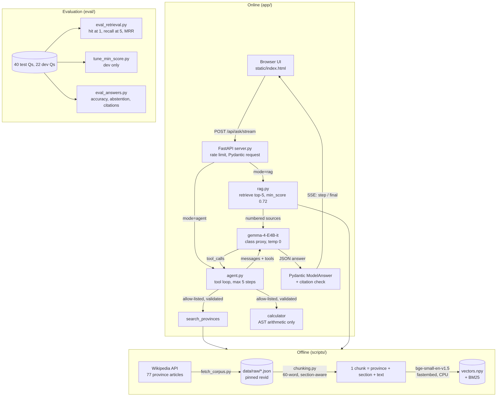

# Thai Province Guide

A question-answering app about Thailand's 77 provinces. It answers **only** from the
English Wikipedia article for each province, **cites the passage** it used, and **abstains**
when the articles don't contain the answer. Questions that need several facts plus some
arithmetic ("how much larger is Chiang Mai than Kanchanaburi?") go to a **tool-calling
agent** that searches twice and uses a calculator, instead of guessing the maths.

Who it's for: travellers, students and teachers who want a quick, *checkable* fact about a
Thai province (its seal, provincial tree, rivers, parks, history), with a link to the exact
Wikipedia revision the answer came from.

Capstone project for the KMITL LLM-application course. All model calls go through the class
proxy (`from openai import OpenAI`, `model="gemma-4-E4B-it"`).

## Course capability families covered

| # | Family | Where |
|---|---|---|
| 1 | Prompting + structured output with schema validation | `app/schemas.py` (`ModelAnswer`), `app/llm.py` (`chat_structured`: parse → validate → one repair) |
| 2 | Retrieval / RAG with citations | `app/retrieval/` (chunk → embed → index → retrieve, `min_score` floor), `app/rag.py` (numbered sources, citation check) |
| 3 | **Retrieval evaluation** on a labelled test set | `data/eval/`, `eval/eval_retrieval.py`, `eval/tune_min_score.py`, `eval/eval_answers.py` |
| 4 | **Agent loop with tools** (function calling + stop condition) | `app/agent.py`, `app/tools.py` (`search_provinces`, `calculator`; allow-list, Pydantic args, max 5 steps) |
| 5 | Advanced: sandboxed code execution (restricted) | `calculator` evaluates arithmetic through a whitelisted AST walker, never `eval()` |
| 6 | Served interface: REST + SSE streaming UI | `app/server.py` (`/api/ask`, `/api/ask/stream`), `app/static/index.html` |

## Run it

Needs Python 3.11+ and the class proxy key. Tested on Windows 11 / Python 3.14.

```bash
git clone https://github.com/PELY334/thai-province-guide && cd thai-province-guide
python -m venv .venv
source .venv/bin/activate            # Windows: .venv\Scripts\activate
pip install -r requirements.txt

cp .env.example .env                 # then put your OPENAI_API_KEY and OPENAI_BASE_URL in .env
python scripts/check_proxy.py        # lists models, one chat call, checks native tool calling

python scripts/build_index.py        # chunk + embed the committed corpus (~2 min on CPU; downloads
                                     # the 70 MB bge-small model once)
uvicorn app.server:app               # open http://127.0.0.1:8000
```

The corpus (`data/raw/`, 77 JSON files with pinned Wikipedia revision ids) is committed, so
you don't need to fetch it. `python scripts/fetch_corpus.py` re-downloads it if you want.

API without the UI:

```bash
curl -X POST http://127.0.0.1:8000/api/ask -H "Content-Type: application/json" \
     -d '{"question": "What is the provincial tree of Lampang?", "mode": "rag"}'
curl -N -X POST http://127.0.0.1:8000/api/ask/stream -H "Content-Type: application/json" \
     -d '{"question": "How much larger is Chiang Mai than Lamphun in km2?", "mode": "agent"}'
```

Tests (offline: no key, no network, no model download): `python -m pytest -q`

## How it works



1. **Corpus.** `fetch_corpus.py` pulls the plain-text extract of each province article
   through the MediaWiki API and stores `pageid`, `revid` and a permanent `oldid` URL.
2. **Chunking** (`chunking.py`). Split on `== Section ==` headings, pack whole paragraphs
   (or whole sentences) up to 60 words, never cut a sentence, drop "References"/"See also".
   Each chunk is embedded as `"<Province> province. <Section>. <text>"` so the province name is
   always in the vector even when the sentence only says "the province".
3. **Index** (`index.py`). L2-normalised `bge-small-en-v1.5` vectors in a numpy array
   (cosine = dot product) plus a small BM25. Modes: `dense`, `bm25`, `hybrid` (RRF).
4. **min_score floor.** Hits whose dense cosine is below `MIN_SCORE` are dropped; if none
   survive, the app answers "I can't answer that…" **without calling the LLM**.
5. **RAG** (`rag.py`). Top 5 chunks are shown to the model as numbered, untrusted sources.
   The model must return `{"answer", "citations", "abstain"}`; Pydantic rejects an answer with
   no citation; citations that point at a source we didn't send are dropped, and an answer left
   with no valid citation becomes an abstention.
6. **Agent** (`agent.py`). Native OpenAI function calling with two tools. Every call is
   checked against an allow-list, its arguments are validated by a Pydantic model, tool errors
   go back to the model as text, tool results are wrapped as untrusted data. The loop stops on a
   final answer, after 5 model turns (then it must answer with what it has), or on a repeated
   identical call. `AGENT_MODE=json` switches to a text JSON protocol for servers without
   native tool calls.
7. **Server** (`server.py`). FastAPI, per-IP rate limit, upstream errors mapped to 429/502/504,
   SSE stream of agent steps then the final answer; stops the agent if the client disconnects.

Configuration is environment-only (`app/config.py`, `.env.example`); no secret is in the repo.

## Evaluation

All numbers below are produced by scripts in `eval/`, saved as JSON in `eval/results/`
(one line per question, so every number can be audited), and rendered by
`python eval/make_tables.py` into [`eval/results/RESULTS.md`](eval/results/RESULTS.md).

```bash
python scripts/build_index.py --chunk-words 60 120 250   # indexes for the chunk-size study
python eval/eval_retrieval.py      # retrieval metrics, no LLM calls, deterministic
python eval/tune_min_score.py      # chooses MIN_SCORE on the DEV set (LLM calls)
python eval/eval_answers.py        # closed_book / rag_no_floor / rag / agent on the TEST set
CHUNK_WORDS=250 MIN_SCORE=0 python eval/eval_answers.py --systems rag --tag @w250_nofloor
python eval/make_tables.py
```

**Test set** (`data/eval/questions.jsonl`, 40 questions, written by hand from the corpus):
23 single-fact questions, 7 "reverse" questions that don't name the province ("Which
province's slogan calls it the coldest place in Siam?"), 4 multi-hop + arithmetic questions,
and 6 questions the corpus cannot answer (restaurants, exchange rates, the current governor).
Each answerable item has gold answer aliases and a gold **evidence string** that must appear in
the retrieved chunk, so relevance labels don't depend on chunk size.

**Dev set** (`data/eval/dev_questions.jsonl`, 22 questions: 12 answerable, 10 unanswerable,
none in the test set) is used only for tuning `MIN_SCORE`.

Temperature is 0 everywhere. Answer correctness is a fixed string rule (gold alias contained
in the answer, commas in numbers ignored), not an LLM judge, so it is reproducible; it can
under-count correct paraphrases, which we checked by reading the per-question outputs.

### 1. Answers: RAG vs the no-retrieval baseline (test set)

| system | answerable correct | single | reverse | multi + calc | unanswerable: abstained | citation precision |
|---|---:|---:|---:|---:|---:|---:|
| **closed_book** (baseline, no retrieval) | 2/34 (5.9%) | 2/23 | 0/7 | 0/4 | 6/6 | – |
| rag, naive default (250-word chunks, no floor) | 31/34 (91.2%) | 23/23 | 5/7 | 3/4 | 6/6 | 75.0% |
| rag, 60-word chunks, no floor | 31/34 (91.2%) | 23/23 | 7/7 | 1/4 | 6/6 | 80.5% |
| **rag** (shipped: 60 words, `MIN_SCORE` 0.72) | 30/34 (88.2%) | 23/23 | 5/7 | 2/4 | 6/6 | 84.2% |
| **agent** (shipped, tools) | 30/34 (88.2%) | 21/23 | 5/7 | **4/4** | 6/6 | 82.5% |

The same model without retrieval gets 2 of 34 facts right, says "I don't know" on 16, and
confidently invents the other 16 (Lampang's seal "features a horse"; Phuket's area "484 km²"). With retrieval it gets 30–31. The agent is
the only system that solves all four multi-hop arithmetic questions: single-shot RAG either
abstains or does the subtraction in its head and gets it wrong (q33: "20,736 − 10,589 =
9,147"). Re-running every system gave the same correct/incorrect outcome on all 40 questions
(temperature 0; 3 answers changed wording only).

### 2. Measured improvement: chunk size (retrieval, test set, k = 5)

| retriever | 250 words (naive) | 120 words | **60 words** |
|---|---:|---:|---:|
| BM25 recall@5 | 0.868 | 0.868 | 0.853 |
| dense recall@5 | 0.897 | 0.897 | **0.971** |
| hybrid (RRF) recall@5 | 0.912 | 0.941 | 0.897 |
| dense hit@1 / MRR | 0.882 / 0.897 | 0.853 / 0.882 | 0.765 / 0.846 |

Going from 250- to 60-word chunks raised dense recall@5 from 0.897 to 0.971 (the gold
passage is in the top 5 for 33 of 34 questions instead of 30–31), at the cost of hit@1. Since
the model reads all 5 passages, recall@5 is the number that matters, so we ship 60 words,
dense. Hybrid RRF did **not** beat dense here (BM25 is the weaker ranker and drags it down),
so the simpler retriever won. Honest caveat: at the answer level the two chunk sizes tie
(31/34 each); the gain shows up in retrieval and in citation precision (75.0% → 80.5%).

### 3. Choosing `MIN_SCORE` (tuned on the dev set, applied once to the test set)

| floor | dev overall (22 Qs) | dev questions that never reach the LLM |
|---:|---:|---:|
| 0.00 (no floor) | 95.5% | 0% |
| 0.65 | 100% | 13.6% |
| **0.72 (chosen)** | **100%** | **40.9%** |
| 0.73 | 95.5% | 50.0% |
| 0.75 | 90.9% | 54.5% |

Rule: best end-to-end score on dev; ties go to the higher floor (same quality, fewer LLM
calls). On the test set the floor of 0.72 stops 4 of the 6 unanswerable questions **before**
any LLM call (6 of 40 questions overall) and keeps abstention at 6/6. It costs two answerable
questions (q11, whose best passage scores only 0.689, and q29, below) and happens to fix one
(q33, because the passage with a conflicting figure drops out): net 31 → 30. A retrieval-only sweep would have
picked 0.73, which on test would have thrown away 15% of answerable questions; tuning on the
end-to-end dev score avoided that. Gemma already abstains well by itself, so the floor is
mainly a cost and safety guard, not an accuracy gain, and we say so.

### Failure cases (from `eval/results/answers_*.jsonl`)

- **q29 – a fact split from its subject.** "Which dam in Tak created the largest artificial
  lake?" The 60-word chunk with "the artificial lake… is the largest in Thailand" doesn't
  contain the dam's name, which is in the previous sentence/chunk; with the floor that chunk
  drops out, so RAG answers "the sources don't say which dam". Small chunks have a price.
- **q16, q20, q22 – the agent didn't search.** The agent abstained on three easy questions
  with zero tool calls; single-shot RAG got all three. Next step: force a first
  `search_provinces` call (`tool_choice="required"`) and re-evaluate on dev.
- **q33 – the corpus disagrees with itself.** The Nakhon Ratchasima article gives 20,494 km²
  in one place and 20,736 km² in another. We found this through the eval and now accept
  both differences (documented in the question's `note`).
- **Found in manual testing (not in the test set): a cited but wrong quantity.** "How much
  larger is Chiang Mai than Lamphun?" The Lamphun article has no total area, only "total
  forest area is 2,588 km²", and the agent subtracted that. The citation makes the error easy
  to spot, but the system did not catch it. A check that the cited sentence matches the asked
  quantity is the next fix.
- **A bug in our own metric.** The first "I don't know" detector for the closed-book baseline
  missed "I do not have specific information…", which under-counted its abstentions (4/6
  instead of 6/6). Found by reading the outputs, fixed, unit-tested, re-scored without new
  model calls (`--rescore`).
- **q13 – our own label was wrong.** Bangkok's seal also shows Indra on Airavata; the agent
  answered "Bangkok" and was marked wrong. Label fixed and noted. Both label fixes were made
  before the final run, and `python eval/eval_answers.py --rescore` re-scores saved answers.

## Limitations and next steps

- **Small test set.** 34 answerable questions: one question is ±2.9 points. Differences of
  one or two questions (e.g. RAG vs agent on single facts) are noise.
- **Wikipedia extracts have no infoboxes or tables**, so population and many statistics are
  missing; the app correctly abstains on them, but a user would expect an answer.
- **Cosine floors are coarse.** The cosines of answerable and unanswerable questions
  overlap (0.64–0.73), so any floor trades recall for early abstention. The model's own
  abstention does most of the work; the floor mainly saves LLM calls on clearly off-topic input.
- **Small chunks can split a fact from its subject** (see failure case q29).
- Next: embed with the proxy's `bge-m3` (the backend is implemented; building the index was
  too slow through the shared proxy during this project), add a cross-encoder reranker, add
  infobox data as a SQL tool, and grow the test set to 100+ items with a second annotator.

## Repo layout

```
app/            config, LLM client, schemas, rag, agent, tools, server, static UI
app/retrieval/  chunking, BM25, embeddings, index/search
scripts/        fetch_corpus.py, build_index.py, check_proxy.py
data/raw/       the corpus (CC BY-SA 4.0, see data/README.md)
data/eval/      test and dev sets
eval/           evaluation scripts and results/
tests/          offline unit tests (pytest)
docs/           architecture diagram, report
```

Corpus text © Wikipedia contributors, CC BY-SA 4.0. Code: MIT.
